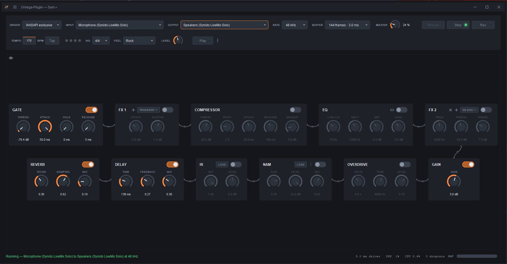

# Omega-Plugin

A guitar effects processor for Windows and Linux. Plug your interface in, pick it in the app, and play through
a board of pedals — gate, compressor, EQ, gain, an overdrive that is five drives from a dropdown, an
amp voiced as five amplifier families, an amp capture, a cabinet that is a loaded impulse response or
one of four synthesised ones, FX slots, delay, reverb and a master volume — with a metronome and a
drum machine above it. Pedals drag into
any order, and FX slots are added and removed. A split switch puts a second board under the first,
fed the same guitar and heard with it, so one sound can be a clean amp and a driven one at once.
Despite the name, it is not an IDE plugin — "plugin" here means a guitar effect.

**New to it?** The [user manual](docs/manual.md) explains every control in the program, in plain
language, from plugging in to the loop box. The same link is under **☰ → About** in the program.



The picture is a real stream: WASAPI exclusive at 48 kHz and 144 frames — 9.0 ms by the driver's own
reckoning, 1 % DSP and no dropouts. Every module the program has is on the board; the greyed ones are
switched off, and `IR` and `NAM` are greyed because neither has a file loaded. Nothing sampled or
captured ships with the program, which is why those two have a LOAD button and no factory content.

## Get it

From the [Releases page](https://github.com/Sam-GN/Omega-Plugin/releases):

**Windows** — download `Omega-Plugin-<version>-Windows.zip`, unzip it anywhere you can write to, and
double-click `OmegaPlugin.exe`. Keep the folder together: the `.exe`, `app\` and `runtime\` are one
unit. A `READ-ME-FIRST.txt` in the folder repeats this and the troubleshooting steps below.

**Linux** — download `Omega-Plugin-<version>-Linux.AppImage`, make it executable and run it:

    chmod +x Omega-Plugin-*-Linux.AppImage
    ./Omega-Plugin-*-Linux.AppImage

One file for every distribution — Arch, Manjaro, Debian, Ubuntu, Mint, Fedora, and the immutable
ones such as SteamOS and Bazzite. It works with whatever sound system the machine has. For the lowest
latency, install your distribution's PipeWire JACK package (`pipewire-jack`; on Fedora
`pipewire-jack-audio-connection-kit`); without it, Omega uses ALSA, through the sound server or
straight to the card. If nothing happens when you run it, your system may lack FUSE 2; running it
with `--appimage-extract-and-run` works without.

Nothing to install on either. Java is inside, so an older Java already on the machine cannot
interfere.

**Updating.** **☰ → About → Check for updates** asks GitHub for the newest release and, if there is
one, shows its notes and an **Update** button that downloads it, checks it and replaces the
installed program in place — the AppImage swaps itself, the Windows folder is refilled so shortcuts
keep working. The first version that can be updated *into* is the one after 1.8.0-beta. By hand it
still works the old way: on Windows unzip the new version over the old folder; on Linux download the
new AppImage, `chmod +x` it and delete the old file. Nothing is lost either way: settings and presets
live in `%APPDATA%\omega-plugin` on Windows and `~/.config/omega-plugin` on Linux, and recordings in
an `Omega-Plugin` folder on the Desktop or in the home folder, all outside the program itself.

x64 only, and beta. On Windows it has been played through one audio interface; on Linux it has run
on one laptop, and no guitar interface has been tried there yet.

## Network

Omega-Plugin never connects to the internet on its own. The only two times it does are the two
presses under **☰ → About**: **Check for updates**, one request to github.com for the release list,
and the **Update** button that may follow, which downloads the bundle and its checksum file from the
same place. Nothing runs at startup, nothing on a timer, nothing when a stream fails.

The one honest caveat: github.com sees the requesting IP address, as it does for any download. Omega
adds no identifier, no settings and nothing about the machine beyond the user agent GitHub's API
requires, which is the program's name and version. A test, `NoNetworkOutsideUpdaterTest`, fails the
build if any code outside the update package so much as names a network type.

## First run

- Pick your audio interface in the device row, input and output.
- In **DRIVER**, choose ASIO if your interface's maker provides an ASIO driver. It is the lowest
  latency by a wide margin. WASAPI exclusive needs no extra driver and is the next best. Java Sound
  is the fallback and is not for playing through.
- **BUFFER** sets the latency. 64 frames is the low-latency setting; 128 is the comfortable one. If
  you load an amp capture, use 128.
- Amp captures (`.nam`) and cabinet impulse responses (`.wav`) are loaded with the LOAD button on the
  `NAM` and `IR` pedals. None ship with the program. Without either, the `AMP` pedal's dropdown
  gives you an amplifier family and the `IR` pedal's dropdown a synthesised cabinet — voicings of
  the real things rather than models of them, and a capture of a real amp beats the voicing.
- The strip above the board has three switches. The eye hides the pedals that are off. The fork
  splits the board in two: both boards play at once, each with its own LEVEL in its header, and the
  fork again puts the second away. Two boards each carrying an amp capture need **256 frames** or
  more; the status line says so.
- The loop between them opens the loop box above the boards: up to four lanes of a minute each.
  REC records a lane from the top of the loop — the first one you record sets the loop's length —
  and ORDER says whether it plays back under your guitar or into the start of the chain, through the
  pedals. SAVE and LOAD take a lane to and from a WAV file, KEY binds a key or a footswitch to a
  lane's ON, and the pop-out icon puts the whole loop box in a window of its own.

## Latency

Choose the driver in the DRIVER picker; the app falls back down the list on its own and says why.

| Backend | Round trip on the interface this was built against | Notes |
| --- | ---: | --- |
| ASIO | **6.4 ms** at 64 frames, **9.9 ms** at 128 | Needs a driver from your interface's maker. Lowest stable size measured: 16 frames. |
| WASAPI exclusive | 18.0 ms at 264 frames | No extra driver needed. Takes sole control of the device. |
| Java Sound | ~160-200 ms | Always available, never fast. For checking a signal path, not for playing. |

On Linux the drivers are different, and so far measured only on one laptop's built-in card:

| Backend | Measured | Notes |
| --- | ---: | --- |
| JACK / PipeWire | not yet on a guitar interface | Linux's equivalent of ASIO. Needs `pipewire-jack` (or a running jackd). The server owns the rate; BUFFER asks it to resize. |
| ALSA | 16 ms at 256 frames, clean | `Default` goes through the sound server and coexists with other programs; the `(direct)` entries reach the card itself, while nothing else holds it. |
| Java Sound | ~50-200 ms | As on Windows. |

Those are the driver's own figures. For a true cable-to-cable measurement, patch a lead from the
output back into the input and run `--measure` (see below).

RATE and BUFFER sit next to each other because both are latency controls: the callback period is
frames divided by rate, so 128 frames is 2.90 ms at 44.1 kHz and 2.67 ms at 48 kHz. The rates on
offer are the output's. A rate marked **C** is one the input cannot do itself — a 44.1 kHz-only
interface into a 48 kHz-only HDMI output, say — so the input runs at its own rate and is converted
on the way in, which adds about 0.7 ms; the status line says which device and how much. The output
is never converted. On ASIO the interface is both ends and there is one rate.

## If it sounds wrong

Crackles, dropouts or a long delay almost always mean the wrong driver loaded. Open a Command Prompt
in the folder and run:

```
OmegaPlugin.exe --list-backends > report.txt
```

`report.txt` names every audio backend that loaded and, for each that did not, why. If ASIO is
missing, install your interface's ASIO driver. If the delay is around 200 ms, you are on Java Sound.

To check the machine keeps up with the effects on and under memory pressure:

```
OmegaPlugin.exe --selftest --chain --stress <input-device> <output-device> 60 > report.txt
```

Watch `realtimeRatio`, not `deadlineMisses`. Below 100 % means audio was lost even if
`deadlineMisses` reads zero. If it drops, raise BUFFER.

The output is redirected to a file because `OmegaPlugin.exe` is a windowed program and prints nothing
to the console on its own. When reporting a bug, attach `report.txt`.

On Linux, run the same commands on the AppImage from a terminal, for example
`./Omega-Plugin-*-Linux.AppImage --list-backends`. They print directly. The last line says whether
the audio thread can get realtime priority. If it cannot, it names the fix for your distribution,
which is usually joining the `realtime` or `audio` group and logging back in. Without realtime
priority, the sound crackles under load.

## For developers

Kotlin on the JVM, Swing for the UI, JNA for the native audio backends — ASIO and WASAPI on
Windows, JACK and ALSA on Linux. There is no native build
step. `CLAUDE.md` is the architecture guide and `CONTRIBUTING.md` the short list of rules that get a
patch turned down; `docs/` holds the rest.

Building needs **Java 21 or newer** on the machine (the Gradle toolchain will download one if it is
missing). Build with `./gradlew build` (`.\gradlew.bat build` on Windows). The result is
`build/libs/OmegaPlugin-<version>-all.jar`, together with the `omega.bat` / `omega.sh` launchers
written beside it. **Use the launchers.** They set the JVM flags the low-latency path depends on,
and a bare `java -jar` cannot be given them — the app detects that and says so. The launchers run the
same diagnostics as the `.exe`, printing to the console directly: `--list-backends`,
`--list-devices`, `--selftest` and `--measure`.

`./gradlew appImage -Pappimagetool=<path>` builds the Linux AppImage, on Linux only, given
[appimagetool](https://github.com/AppImage/appimagetool). It needs a vendor JDK 21 such as Temurin as
the build toolchain: the image names the exact runtime it ships, and a distribution's own JDK does
not record that, so the build stops rather than leave it out.

`gradlew.bat exeZip` builds the self-contained Windows x64 zip from the Releases page: a bundled
Java 21 and one real launcher, `OmegaPlugin.exe`, with the JVM flags inside it so there is no way to
start it without them. `gradlew.bat portableZip` builds the same bundle with `.bat` launchers
instead, where `omega.bat` prints to the window directly. Neither is part of `build`, because jlink
and jpackage cost tens of seconds on every compile.

A push to `main` is a release: once the build has passed on Windows and Linux, the release workflow
reads the version from `build.gradle.kts`, builds the Windows zip and the Linux AppImage, and
publishes both in one draft release tagged with it. Every change therefore bumps the version and adds a `CHANGELOG.md` entry.

Linux support is new in 1.1.0. `docs/linux-compat.md` records what is done and what is still open.

## Source and redistribution

Source code: <https://github.com/Sam-GN/Omega-Plugin>

This is a GPL program, so a binary has to reach people together with the source it was built from.
Publishing a release on the repository above satisfies that — the tag the release is built from *is*
the Corresponding Source, offered from the same place as the download, which is what GPLv3 §6(d)
asks for. If a build is ever handed out any other way, it needs either the source alongside it or a
written offer for it, valid three years — §6(a) and §6(b).

`LICENSE` is packed inside the jar and into `distZip`, so a copy handed over on its own still carries
its licence. JNA's own notices ride along in `META-INF/`, where LGPL 2.1 §6 wants them. The same text
is in the application under **☰ → Licences**, which is the one place to change the URL above:
`ui/Licences.kt`.

## Licence

Copyright (C) 2026  Sam Ganji &lt;sam.ganji.n@gmail.com&gt;

This program is free software: you can redistribute it and/or modify it under the terms of the GNU
General Public License as published by the Free Software Foundation, either **version 3 of the
License, or (at your option) any later version**.

This program is distributed in the hope that it will be useful, but WITHOUT ANY WARRANTY; without
even the implied warranty of MERCHANTABILITY or FITNESS FOR A PARTICULAR PURPOSE. See the GNU
General Public License for more details.

You should have received a copy of the GNU General Public License along with this program. If not,
see <https://www.gnu.org/licenses/>.

The full text is in [LICENSE](LICENSE), taken verbatim from
<https://www.gnu.org/licenses/gpl-3.0.txt>.

### Third-party licences

Every component in the jar is GPLv3-compatible on its own terms. The reasons are recorded beside
the names because a compliance reader wants to see that each licence was looked at, not just listed.

| Component | Licence | Note |
| --- | --- | --- |
| Kotlin stdlib | Apache 2.0 | GPLv3-compatible. The Apache 2.0 text ships in the jar at `META-INF/AL2.0`. |
| JetBrains annotations 13.0 | Apache 2.0 | Not declared anywhere in the build — it arrives transitively under the Kotlin stdlib and ends up in the jar. GPLv3-compatible, the same as the stdlib. |
| JDK (runtime) | GPLv2 with Classpath Exception | The exception is what permits linking without infecting the application. The Windows zip and the Linux AppImage each bundle an Eclipse Temurin build; the zip's `READ-ME-FIRST.txt` and the AppImage's `RUNTIME-NOTICE.txt` name the exact build, and the source is published by Adoptium at <https://github.com/adoptium/jdk21u>. |
| JNA (`jna` + `jna-platform`) | Apache 2.0 **or** LGPL 2.1 | Dual-licensed, and both options are GPLv3-compatible. This project **takes it under LGPL 2.1**, so its notice obligations are the LGPL's: the texts ride along in `META-INF/`. |

This is the contents of the jar, which is the set the licences apply to. The *declared* dependencies
are fewer — JNA is the only third-party library this project asks for by name, and it is there so
that ASIO and WASAPI can be reached with no native build step and no extra binaries to ship. Verify
the table against `gradlew dependencies --configuration runtimeClasspath` rather than against the
`dependencies` block, which is how the annotations entry came to be missing.

The Steinberg ASIO SDK is deliberately **not** used. The ASIO backend declares the `IASIO` COM vtable
directly, from its published layout, and contains no Steinberg code — so there is no native build
step, nothing vendored, and no second licence to carry.
